<div align="center">


<picture>
  <source media="(prefers-color-scheme: dark)" srcset="web/brand/wordmark-dark-512.png" />
  
</picture>

### Meetings and chat that send only what matters.

Video meetings, calls, chat, channels, a whiteboard, recording and live transcripts:<br/>
one Go server and one browser client, measured down to the byte.

<br/>


[**Features**](#everything-a-team-needs-to-meet) · [**Why it is different**](#the-difference-is-measured) · [**Privacy**](#private-by-construction) · [**Architecture**](#architecture) · [**Run it**](#run-it-in-two-minutes) · [**Engineering**](#how-it-is-built)

<br/>

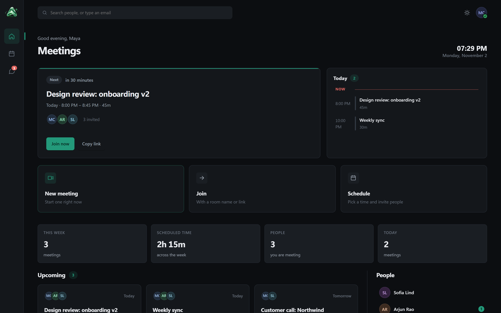

</div>

<br/>

## The idea

Most of what a video call puts on the wire is not picture or sound. It is headers, repeated
JSON, frames that nobody can see and bitrate spent on pictures that did not change. Aether
removes those bits, and only those. **Quality is never traded for bandwidth.** Every byte it
saves is a byte that carried no information.

That is a claim anyone can make, so every number in this file comes from a packet capture or
a test in this repository. Where a measurement was disappointing, it is published as well.

<br/>

## Everything a team needs to meet

<table>
<tr>
<td width="50%" valign="top">

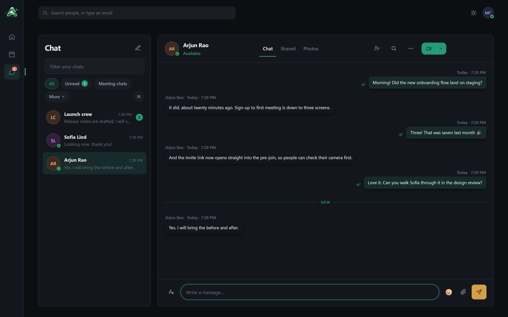

**Chat, the way teams actually talk.** One-to-one, groups, channels with threaded posts,
replies, reactions, mentions, edits with history, forwarding, files, voice messages, polls,
scheduled send, read receipts, typing indicators and presence that knows when you are in a call.
**Teams** hold channels: public ones anyone in your organisation can find, private ones
reached by a seven-character code, each with a General channel and private channels inside.
**Activity** gathers what concerns you (mentions, replies, reactions, team invitations), grouped
by day, with reactions to one message folded into one line, live on every device.

</td>
<td width="50%" valign="top">

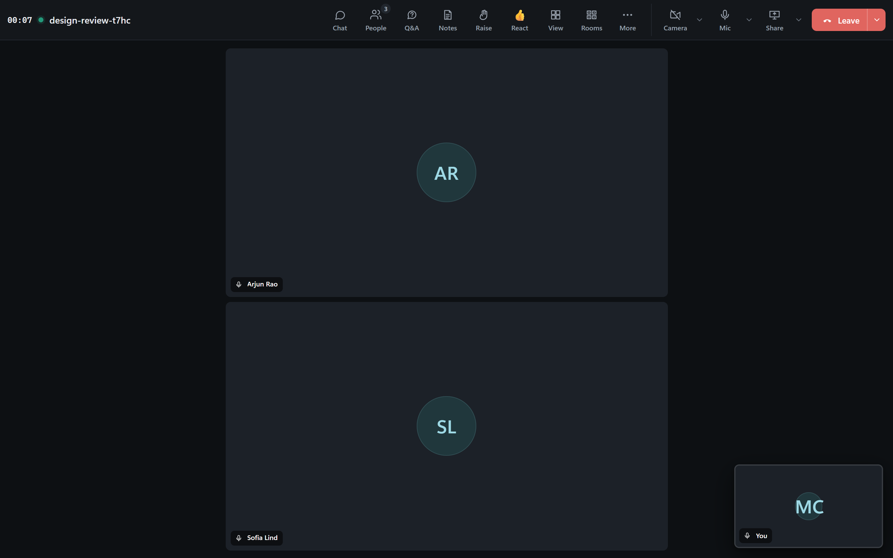

**Meetings laid out the way people already know.** Gallery, speaker and large-gallery views,
a pre-join camera check, a lobby, roles (organizer, co-organizer, presenter, attendee),
spotlight, raised hands in order, mute all, breakout rooms, and "end meeting for everyone".

</td>
</tr>
<tr>
<td width="50%" valign="top">

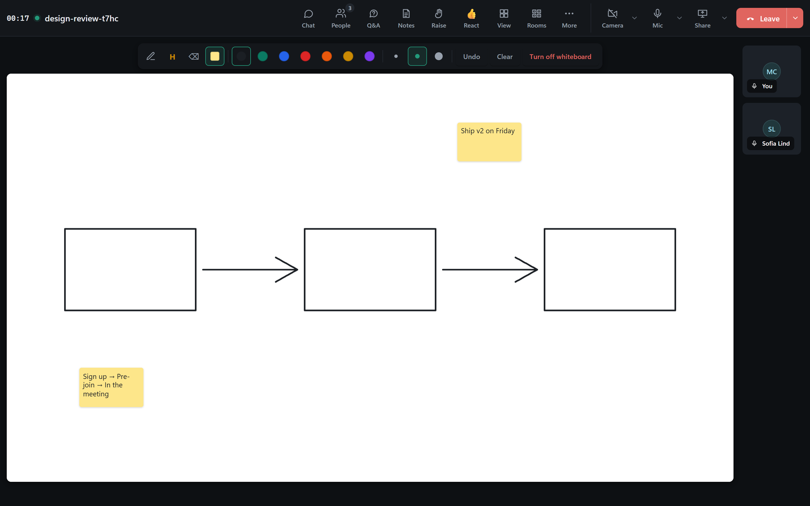

**A whiteboard on the stage.** Pens, highlighter, eraser, sticky notes and undo. Everyone sees
a line *while it is being drawn*. A stroke costs about **2 bytes per point**: 5.9× less than
the same stroke as JSON.

</td>
<td width="50%" valign="top">

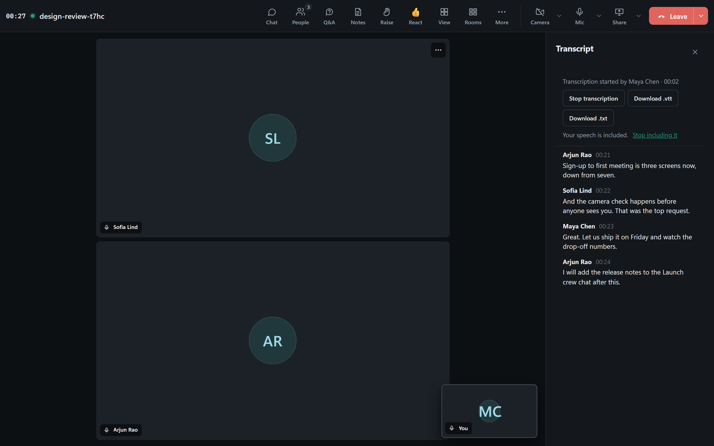

**Recording and live transcripts.** Every line is attributed, because each speaker's own
browser transcribes their own voice: nobody guesses who spoke. Downloads come as `.vtt` or
`.txt`. Recordings are made on the recorder's own computer.

</td>
</tr>
<tr>
<td width="50%" valign="top">

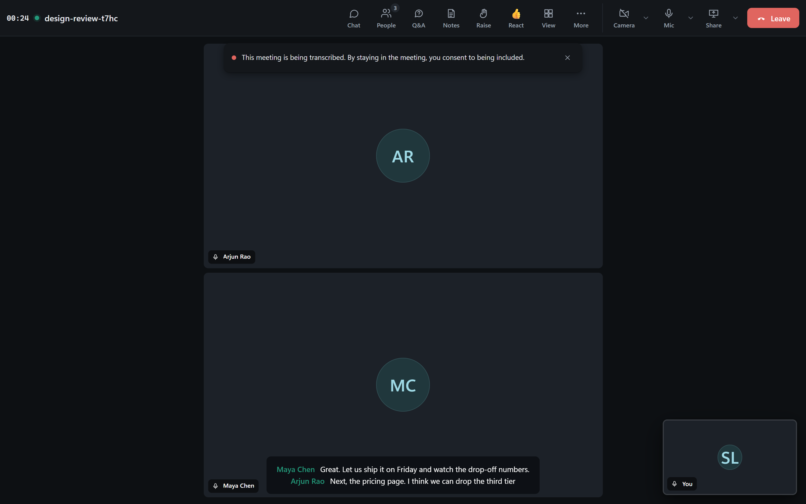

**Live captions for everyone.** Turn them on and you see what everybody says, as they say it.
Each person is asked first whether their speech may be turned into text.

</td>
<td width="50%" valign="top">

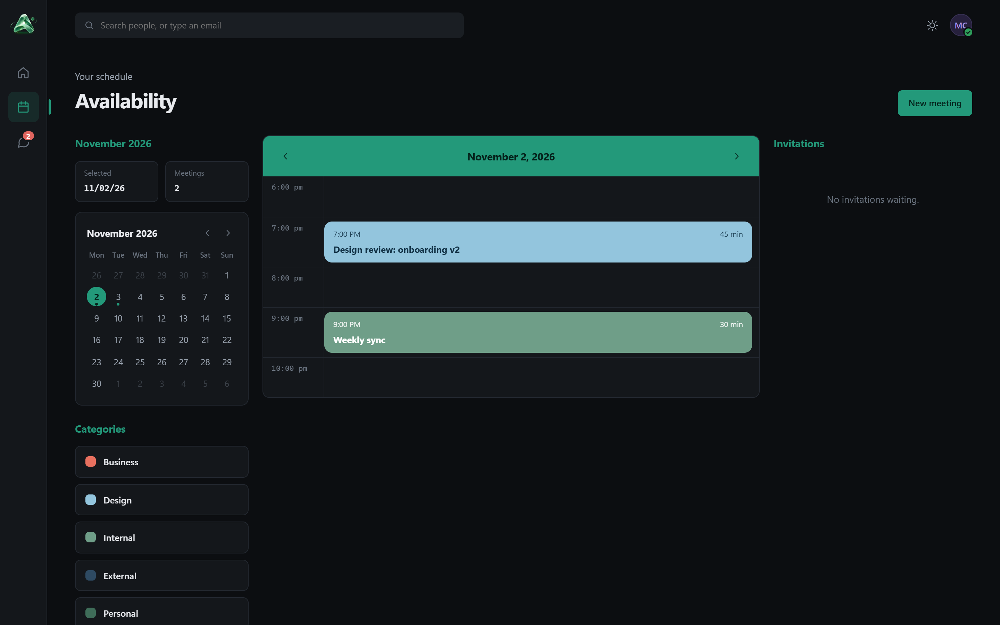

**Scheduling built in.** A calendar with categories, invitations and co-organizers. Meeting
notes with agenda and follow-up tasks. Moderated Q&A. An attendance list you can download.

</td>
</tr>
</table>

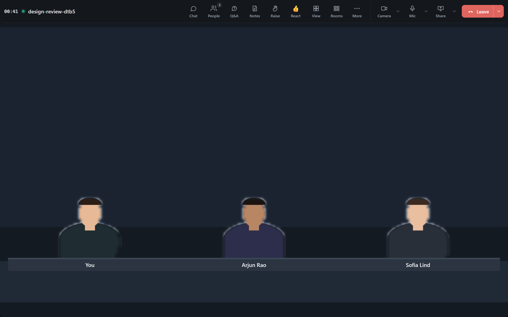

**Together mode.** Everyone is cut out of their own room and seated in one scene. Each person
sends only the *outline* of themselves, 63 bytes, and only when it changes, so nobody's computer
has to cut out anybody else. A person sitting still costs nothing at all.

<div align="center">
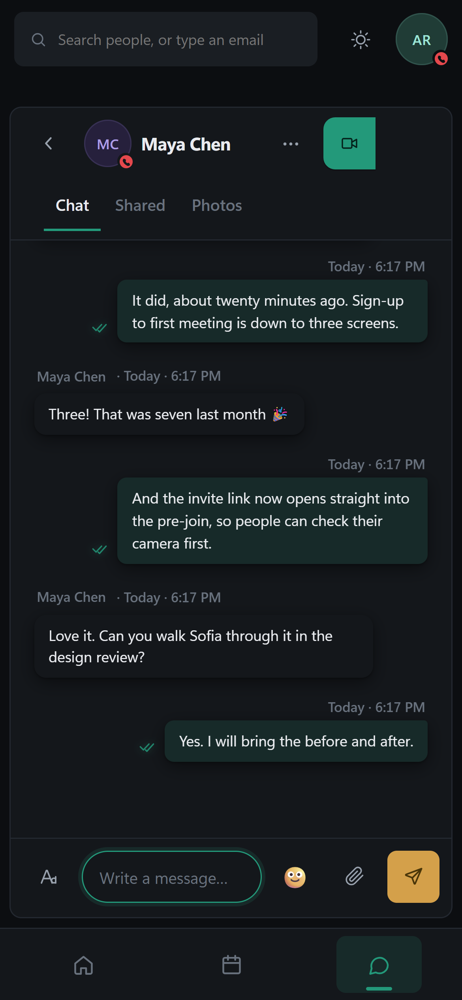
&nbsp;&nbsp;
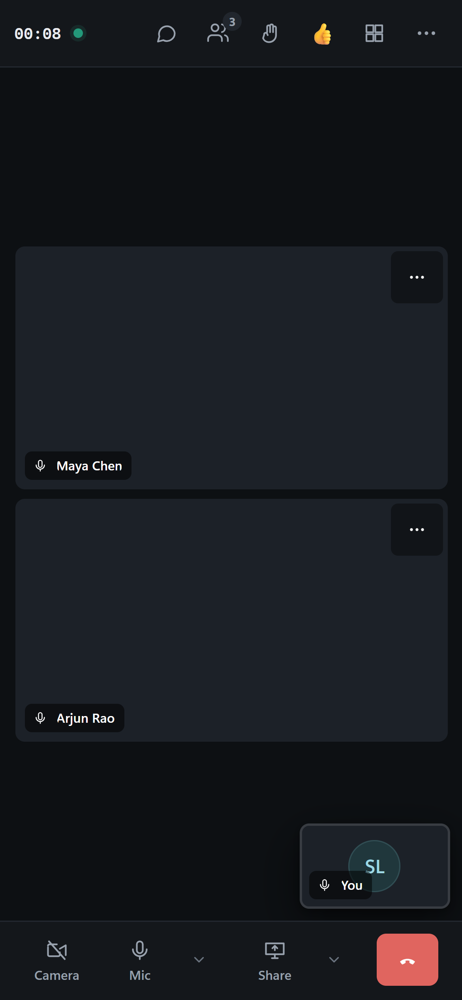
<br/>
<sub><b>One codebase, every screen.</b> A 360 px phone, a tablet, a laptop, a 4K monitor and a native Windows app. An automated layout harness checks every screen and fails on anything that overflows, overlaps, or is too small to tap.</sub>
</div>

<br/>

<details>
<summary><b>The full feature list</b></summary>

<br/>

| | |
| --- | --- |
| **Meetings** | Video and audio meetings, 1:1 and group calls with ringing · pre-join camera and microphone check · lobby and admission · invite links · screen sharing · gallery, speaker, large gallery and focus-on-content views · spotlight · raised hands, lower all · reactions · mute all · disable an attendee's mic or camera · remove · end for everyone · roles and meeting options · breakout rooms (assign, shuffle, timers, announcements, return) · whiteboard · Q&A with moderation · meeting notes · call health · pop-out |
| **Recording and speech** | Recording made on your own computer · live transcription, attributed per speaker · live captions for everyone · `.vtt` and `.txt` downloads · consent asked before anyone's speech becomes text · a deployment-wide "recording allowed" switch · every start and stop in the audit log |
| **Video** | Background blur, portrait blur, backgrounds, your own images (kept on your device) · soft focus · low-light correction · mirror my video · Together mode (auditorium, café, conference room) · VP9 at constant quality where the browser can |
| **Audio** | Neural noise suppression (RNNoise) · echo cancellation required, with a warning when a device cannot · instant unmute · same-room echo warning |
| **Chat** | 1:1, groups and notes to self · channels (public and private) with threaded posts · formatting · reactions · replies · edit with history · delete and undo send · forward · mentions · read receipts · typing · presence and status, with automatic "in a call" and "away" · pins, saved messages · priority · scheduled send · polls, praise and announcements · files, photos, video clips and voice messages · search · filters · block |
| **Calendar** | Scheduling with categories and invitations · co-organizers · availability · attendance history · "5 minutes left" notice |
| **Administration** | Users and roles · deployment settings · a hash-chained, tamper-evident audit log · remote control with consent, on the Windows app |
| **Clients** | Chrome and Edge · Safari, iOS and Firefox through WebRTC · a native Windows app (Go + WebView2) with tray, badge and notifications |

What is not built yet is listed just as plainly, in [docs/TEAMS_PARITY.md](docs/TEAMS_PARITY.md).

</details>

<br/>

## The difference is measured

Every figure below was captured from real traffic with **tshark** or produced by a test in
this repository. Each one is written up, with its method, in
[docs/ARCHITECTURE.md](docs/ARCHITECTURE.md).

<table>
<tr><th align="left">What</th><th align="right">The usual way</th><th align="right">Aether</th><th align="left"></th></tr>
<tr><td>A participant's state change (mute, camera, hand, role)</td><td align="right">172 B of JSON</td><td align="right"><b>3 B</b></td><td>57× smaller</td></tr>
<tr><td>A heartbeat</td><td align="right">a JSON object</td><td align="right"><b>1 B</b></td><td></td></tr>
<tr><td>A camera that is <i>not moving</i> (socket path)</td><td align="right">579 kbit/s at a VP8 target</td><td align="right"><b>49–81 kbit/s</b></td><td>VP9 at constant quality, sharper (+5 dB)</td></tr>
<tr><td>A camera with its background blurred</td><td align="right">376 kbit/s unblurred</td><td align="right"><b>88 kbit/s</b></td><td>blurred detail is not sent</td></tr>
<tr><td>A 200-point whiteboard stroke</td><td align="right">2,421 B as JSON</td><td align="right"><b>409 B</b></td><td>2 bytes a point</td></tr>
<tr><td>A person's outline in Together mode</td><td align="right">~440 B as JSON</td><td align="right"><b>63 B</b></td><td>and nothing while they sit still</td></tr>
<tr><td>A spoken sentence, as live captions</td><td align="right">945 B as JSON</td><td align="right"><b>289 B</b></td><td>3.3× smaller</td></tr>
<tr><td>Searching 50,000 people per keystroke</td><td align="right">28 ms with <code>LIKE</code></td><td align="right"><b>0.5 ms</b></td><td>index-backed, with a scale test</td></tr>
<tr><td>A meeting where nobody is doing anything</td><td align="right">keep-alives and polls</td><td align="right"><b>nothing</b></td><td>idle costs zero</td></tr>
<tr><td>One person flooding 500 reactions into a 200-person meeting</td><td align="right">500 frames to each of 199</td><td align="right"><b>4</b></td><td>held to an allowance before the fan-out</td></tr>
</table>

**Under load, with the numbers.** `tools/e2e/stress.mjs` puts 50 or 200 people, each with their
own account and address, through chat, reactions, @mentions, teams, the activity feed and a
meeting (hands, reactions, whiteboard, Together mode, floods) at once. At 200 people a burst of
1,000 messages became 199,000 deliveries: none lost, none repeated, none out of order. When
everyone leaves, the server is back to 17 goroutines, with no rooms or media routes left. The run
found five defects and fixed them. It also found a 5,000-member channel paying for a write to
every member's unread counter on each message; large conversations now count unread when it is
read, and a message into one costs 2.4–3.4 ms instead of 8–10 ms on this machine. All of it is in
[ARCHITECTURE §6br and §6bx](docs/ARCHITECTURE.md). The same run with audio, every camera and a screen
share from 50 people delivered 108,961 of 108,961 frames at p99 under 20 ms, and sends each person
only the cameras on their screen: 1.0 Mbit/s each instead of 4.1
([§6bs](docs/ARCHITECTURE.md)).

**Coalescing, not just encoding, is what makes a connection dense.** At one frame per message,
60 bytes of IP and TCP ride on every tiny payload, and only 27.1% of the bytes are application
data. Gathering frames into 15 ms bursts takes that to **48.0%**, with no change to the
encoding at all. Both numbers are published, because quoting only the flattering one would be
misleading.

**And the honest ones.** A camera in constant motion costs about a fifth *more* under the
constant-quality encoder. That buys about 6 dB of picture quality, and still and blurred pictures
cost far less, so the average meeting comes out well ahead. Rule 3 below says to optimise the
average, and the trade-off is written up rather than hidden.

<br/>

## Private by construction

- **Your voice is turned into text on your own device**, by your own browser, and only after
  you say yes. Where the browser can recognise speech on the device, it does. Where it cannot,
  you are told that its online service will hear you before anything starts.
- **Recordings are made on the recorder's computer.** The server never holds the video; it
  knows only that a recording is running, so it can tell everyone.
- **Background effects run on your device.** The room never receives your unprocessed
  picture. Images you add for your background are never uploaded.
- **A background you asked to hide is never sent.** Until the segmentation model has loaded, or
  if it cannot load, the whole frame is blurred.
- **Turning the camera off turns the camera off.** The device is released and its light goes
  out. A browser test fails if it does not.
- **Security is enforced at the server, not the interface.** Every endpoint checks membership
  before it reads a byte. Every new endpoint is tested as a stranger, as nobody signed in and
  against cross-site requests. Inputs are bounded and tested one past the limit.
- **Accounts:** Argon2id passwords, 256-bit sessions stored only as hashes, and sign-in errors
  that never reveal whether an address exists.
- **Audit:** a hash-chained log. Editing, deleting or reordering any entry breaks the chain,
  and the break can be found.

<br/>

## Architecture

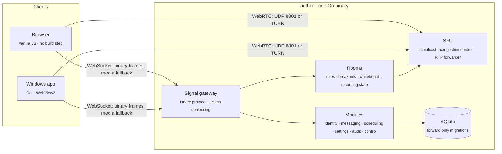

- **A modular monolith.** Each module is a vertical slice that owns its data, and no module
  reads another's internals. The distance between "a packet arrived" and "a packet was
  forwarded" is the product, and every process boundary on that path is a queue.
- **One binary protocol.** Opcodes are one or two bytes, and strings are interned once per
  connection. Frames are self-contained, so a dropped one never costs a repaint.
- **Two media paths.** WebRTC carries the call wherever it can. Where a network blocks it, media
  rides the same WebSocket as the page, encoded with WebCodecs. Nobody is left without a call.
- **No build step.** The browser loads ES modules directly. What runs is what is in `web/src`.

<details>
<summary><b>The repository</b></summary>

```
engine/
  cmd/aether/            the server
  cmd/aether-desktop/    the Windows app (Go + WebView2)
  cmd/bitbudget/         per-layer byte accounting for a whole meeting
  internal/
    wire/                the binary protocol
    signal/              WebSocket gateway, coalescing, meeting features on the wire
    room/                participants, roles, breakouts, whiteboard, recording state
    sfu/                 allocator, congestion control, RTP forwarder
    rc/                  remote-control input codec and safety rules
    ledger/              every byte attributed to a layer
    modules/             identity · messaging · scheduling · settings · audit · control
    platform/            database, HTTP plumbing
web/
  src/                   the client: wire.js, rtc.js, wsmedia.js, app.js, …
  vendor/                RNNoise and MediaPipe, with their licences
tools/
  e2e/                   browser harnesses, the layout harness, tshark drivers
  teams-evidence.mjs     reads an installed Teams package for parity evidence
docs/
  ARCHITECTURE.md        every decision and measurement, including the disappointing ones
  TEAMS_PARITY.md        feature by feature: built, not built, and why
```

</details>

<br/>

## Run it in two minutes

You need **Go 1.25+**. For the browser harnesses, you also need **Node 20+** and Chrome.

```bash
git clone https://github.com/Ambujkumar909/Aether.git
cd Aether/engine
go run ./cmd/aether -addr :8443 -tls -web ../web
```

Open **https://localhost:8443**. On an empty database the server prints a bootstrap
administrator's email and a one-time password. Sign in, then create accounts or invite people.

```bash
# The checks this project holds itself to
cd engine && go test -race ./...              # 495 tests, under the race detector
cd ../web && npm test                         # client unit tests
node ../tools/e2e/layout.e2e.mjs https://localhost:8443   # every screen at phone, tablet and desktop
go run ./cmd/bitbudget -n 4 -minutes 15       # where every byte of a meeting goes
```

<br/>

## How it is built

The project runs on a short list of standing rules ([CLAUDE.md](CLAUDE.md)). A change that does
not meet them is not finished.

1. **Measure every feature at the bit level, when it is built.** Capture it with tshark on the
   real connection. Count every layer, and report payload efficiency next to the raw totals.
2. **No wasted packets.** Coalesce, send nothing when nothing changed, never pay for a header
   twice, and bound every queue.
3. **Quality is never traded for bits.** Optimise the average, not the peak.
4. **Prove the test can fail.** New tests are mutation-checked: break the code and confirm the
   test catches it. Socket tests use real sockets. Everything runs under `-race`.
5. **No cross-frame state unless recovery is cheap.**
6. **Write the measurement down**, including the ones that were disappointing.
7. **Speed, accuracy and security, for 50,000 people.** Every list is index-backed, and every
   push carries what the view draws.
8. **Every screen works on every device**, verified at 390, 820 and 1280 px before it ships.

That discipline has caught real defects: frames reaching the wire in the wrong order under
load, captions hidden behind the gallery, a host handover chosen at random on a clock tie, and
a call chat showing the wrong conversation. Each was reproduced first, fixed, and recorded
with the numbers in [docs/ARCHITECTURE.md](docs/ARCHITECTURE.md).

<br/>

## Where it is going

- **Spatial audio** for Together mode, and segmentation in a worker so effects cost the page
  nothing. (A GPU compositor was built, measured as no faster, and removed.)
- **Calendar views** with a scheduling assistant.
- **Server-side recording** linked from the meeting chat, and a Word transcript.
- **Native mobile apps.** The web client already adapts to phones today.

The full list, including what is deliberately out of scope, is in
[docs/TEAMS_PARITY.md](docs/TEAMS_PARITY.md).

<br/>

<div align="center">

<br/>
<sub>Built with care, and measured.<br/>Third-party components keep their own licences: <a href="web/vendor/rnnoise/LICENSE">RNNoise</a>, <a href="web/vendor/mediapipe/LICENSE">MediaPipe</a>.</sub>
</div>
